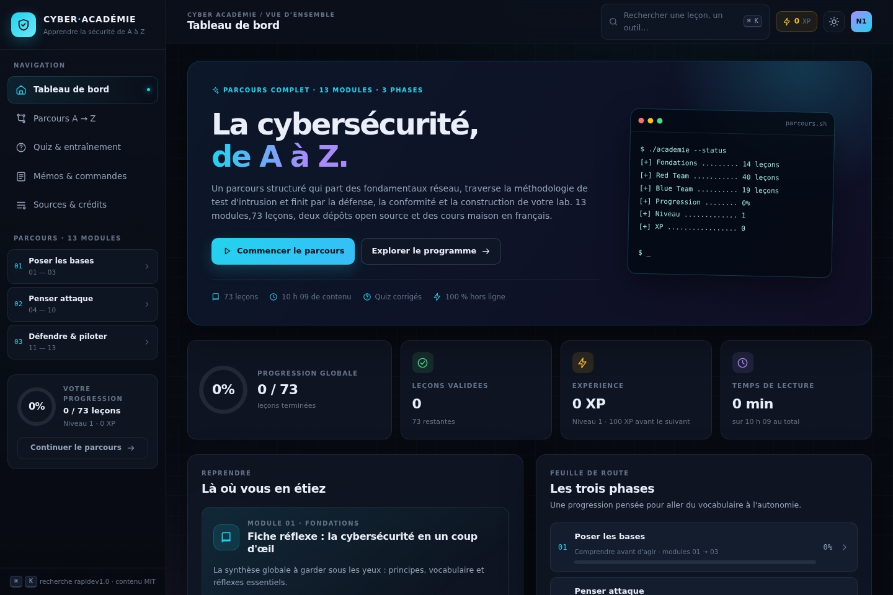
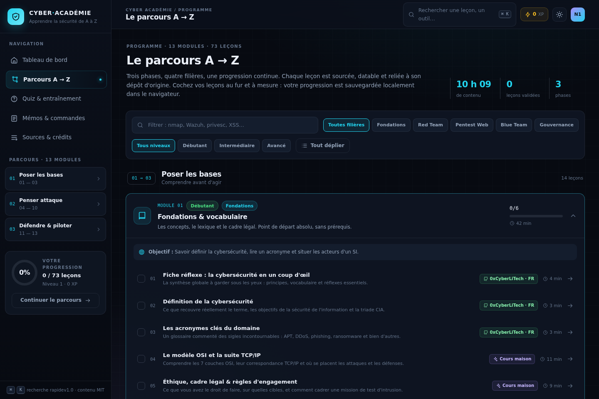

# 🛡️ Cyber Académie — De A à Z

> Plateforme web moderne pour apprendre la cybersécurité **de A à Z**, construite à partir de deux dépôts open source et d'un parcours pédagogique maison en français.



## En bref

| | |
|:--|:--|
| **Contenu** | 73 leçons · 13 modules · 3 phases · ~10 h de lecture |
| **Sources** | [eJPT v2 Certificate Notes](https://github.com/skullhat/eJPT-v2-Certificate-Notes.git) (32 leçons, EN) + [Cybersecurite](https://github.com/0xCyberLiTech/Cybersecurite.git) (18 leçons, FR) + 23 cours maison (FR) |
| **Stack** | React 18 + TypeScript + Vite 6, CSS variables, zéro dépendance UI externe |
| **Données** | 100 % statiques, progression stockée dans `localStorage`, aucun backend ni tracking |
| **Licence des sources** | MIT — attribution conservée, lien vers chaque fichier d'origine |

## Démarrage

```bash
cd cyber-academie
npm install
npm run dev            # http://localhost:5173
npm run build          # typecheck + bundle de production dans dist/
npm run build:site     # build + copie dans site/ (dossier statique servi en preview)
npm run preview        # prévisualisation du build
npm run sync:content   # git pull des 2 dépôts + régénération du catalogue
```

Aucune variable d'environnement, aucune clé API, aucune base de données : l'application fonctionne intégralement hors ligne une fois le bundle servi.

## Fonctionnalités

- **Tableau de bord** — progression globale, XP/niveaux, reprise de la dernière leçon, feuille de route par phase, recommandations personnalisées.
- **Parcours A → Z** — 13 modules, filtres par filière et par niveau, recherche, dépliage, objectifs pédagogiques et validation des leçons.
- **Lecteur de cours** — rendu Markdown sécurisé (titres, tableaux, code, callouts GitHub), sommaire sticky, blocs de code copiables, « En bref » en français pour les notes anglaises, lien vers le fichier source, favoris, navigation précédent/suivant.
- **Quiz** — 45 questions corrigées avec explications, tirage aléatoire, périmètre par module, raccourcis clavier 1–4 / Entrée, meilleur score conservé.
- **Mémos** — 8 familles de commandes (Nmap, Linux, Web, énumération, Metasploit, crypto, défense, cloud), recherche plein texte, copie en un clic, export Markdown.
- **Recherche globale** — palette `⌘K` / `Ctrl+K` / `/` avec index pré-calculé sur titres, mots-clés, résumés et corps des leçons.
- **Thème sombre / clair**, responsive complet (mobile inclus), animations respectant `prefers-reduced-motion`.
- **Sources & crédits** — attribution des dépôts, références officielles, architecture, export/réinitialisation des données locales, avertissement légal.




## Architecture

```
cyber-academie/
├── .sources/                    # clones des 2 dépôts (régénérables)
│   ├── ejpt/                    # notes eJPT v2
│   └── cyber/                   # cours 0xCyberLiTech
├── content/                     # 23 cours maison (.md + front matter)
├── scripts/
│   └── build_content.py         # pipeline : nettoyage → métadonnées FR → catalogue JSON
├── src/
│   ├── data/
│   │   ├── catalog.json         # généré : sources, phases, modules, 73 leçons
│   │   ├── quizzes.json         # 45 questions corrigées
│   │   └── cheatsheets.json     # 8 familles de commandes
│   ├── lib/
│   │   ├── content.ts           # catalogue, index de recherche, helpers
│   │   ├── markdown.tsx         # parseur + renderer React (sans dangerouslySetInnerHTML)
│   │   ├── progress.tsx         # contexte de progression + localStorage
│   │   ├── nav.tsx / icons.tsx
│   ├── components/              # Sidebar, Topbar, CommandPalette, UI
│   └── views/                   # Dashboard, Curriculum, Lesson, Quiz, Cheatsheets, Resources
├── site/                        # build statique prêt à servir (prévisualisation, non commité)
├── docs/                        # captures d'écran de l'interface
├── licenses/                    # licences MIT des deux dépôts sources
├── THIRD_PARTY_NOTICES.md       # attribution complète des contenus tiers
├── Dockerfile / nginx.conf      # déploiement statique conteneurisé
└── .github/workflows/
    ├── build.yml                # CI : typecheck + build
    └── pages.yml                # CD : déploiement GitHub Pages
```

### Pipeline de contenu

Le contenu est **découplé de l'interface** : le front ne lit jamais de Markdown brut au runtime.

1. `scripts/build_content.py` parcourt `.sources/` et `content/`.
2. Il supprime l'habillage HTML des dépôts (headers, badges SVG, blocs pédagogiques répétés), normalize les titres, conserve tableaux, listes, fences de code et callouts.
3. Il applique une table de métadonnées : titre français, module, ordre, résumé, tags et URL GitHub du fichier d'origine.
4. Il calcule durée, nombre de mots et blocs de code, puis écrit `src/data/catalog.json`.

**Ajouter une leçon** : déposer un `.md` dans `content/` avec front matter (`id`, `title`, `module`, `order`, `brief`, `tags`, `minutes`), puis `python3 scripts/build_content.py`. **Ajouter un dépôt** : une entrée dans `REPOS` + `META`, puis `npm run sync:content`.

### Pourquoi c'est scalable

- Catalogue piloté par les données : aucun module ni écran codé en dur ; le nombre de leçons peut croître sans toucher aux vues.
- `catalog.json` peut être remplacé par une API/headless CMS sans changer les composants (une seule fonction `loadCatalog()` à faire évoluer).
- Contenu statique → cache CDN, déploiement multi-régions, pas de serveur applicatif à dimensionner.
- Index de recherche construit une fois ; si le catalogue devient très gros, on peut le remplacer par un index pré-généré ou un moteur côté client (MiniSearch/FlexSearch) sans refonte.

### Pourquoi c'est performant

- Bundle initial ~10 Ko gzip (app) + 45 Ko (React) + 133 Ko (catalogue compressé), **aucune ressource externe** (pas de police, CDN ou script tiers).
- Vues chargées à la demande via `React.lazy`, chunks séparés par Vite, CSS code-split.
- Rendu Markdown mémorisé par leçon, composants de code isolés, recherche sur index normalisé pré-calculé.
- Build `tsc --noEmit && vite build` : zéro erreur de type, cible ES2020.

## Déploiement

```bash
# Image Docker (build multi-étapes → nginx statique)
docker build -t cyber-academie .
docker run -p 8080:80 cyber-academie

# Ou n'importe quel hébergeur statique : publier dist/
# Vercel / Netlify / GitHub Pages / Cloudflare Pages :
#   build command : npm run build
#   output dir    : dist
```

`nginx.conf` active gzip, met en cache les assets fingerprintés et assure le fallback SPA.

### GitHub Pages (déploiement automatique)

Le workflow `.github/workflows/pages.yml` build et publie `dist/` à chaque `push` sur `main`.
Il suffit d'activer **Settings → Pages → Source : GitHub Actions** sur le dépôt.
`vite.config.ts` utilise `base: './'` : les assets restent valides que le site soit servi
à la racine d'un domaine ou sous `https://<user>.github.io/<repo>/`.

## Sources & crédits

Les deux dépôts sont la propriété de leurs auteurs, sous **licence MIT** :

- **skullhat / eJPT-v2-Certificate-Notes** — notes communautaires de préparation à l'eJPT v2, 9 sections (assessment, audit, attaques hôte/réseau, Metasploit, exploitation, post-exploitation, ingénierie sociale, web/HTTP).
- **0xCyberLiTech / Cybersecurite** — atelier français de défense en profondeur (kill chain, malwares, cryptographie, proxys, EDR/SIEM/SOAR/XDR, Wazuh, Suricata, CrowdSec, nftables).

Chaque leçon affiche sa provenance et un lien direct vers le fichier Markdown d'origine. Les cours maison complètent les angles non couverts (OSI/TCP-IP, adressage, OWASP, SQLi/XSS/SSRF, AD/Kerberos, forensic, Wi-Fi, cloud/DevSecOps, ISO 27001, constructions de lab…).

## ⚠️ Cadre légal

Les techniques de scan, d'exploitation et de post-exploitation sont présentées **à des fins pédagogiques**. Ne les pratiquez que sur un laboratoire isolé vous appartenant ou sur un périmètre couvert par une autorisation écrite (règles d'engagement). La plateforme ne fournit aucun outil d'attaque : uniquement du contenu de formation.

---

*Généré le 11 novembre 2026 · Cyber Académie A→Z v1.0*
